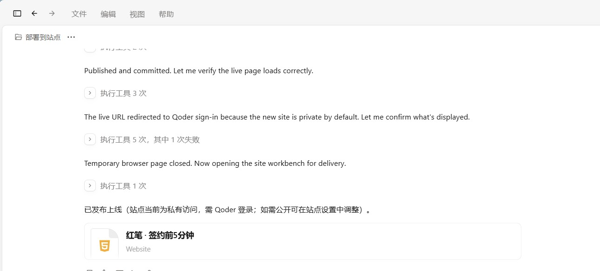
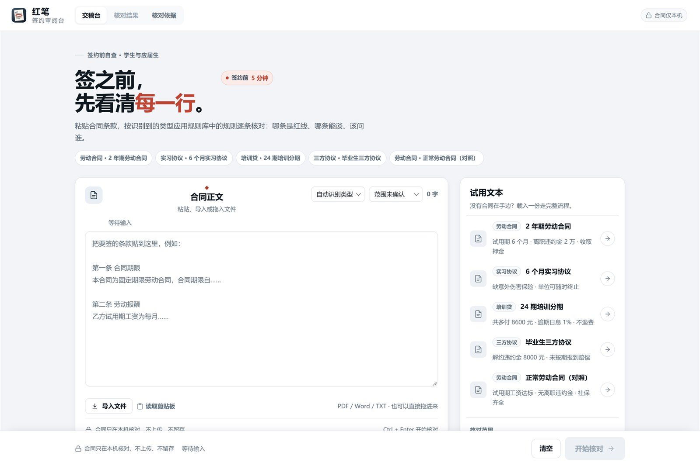
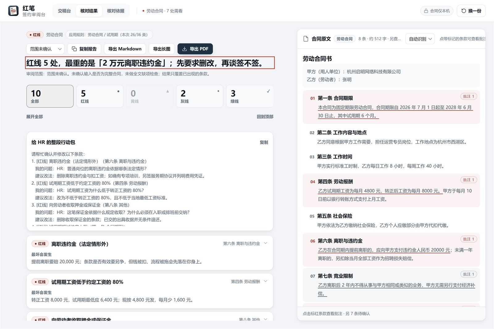
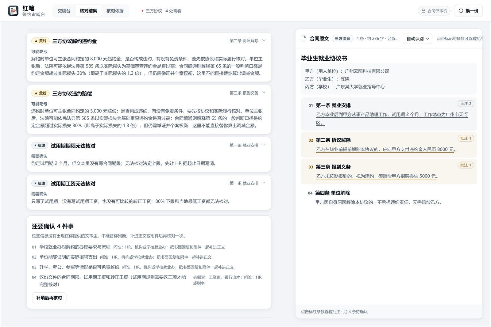
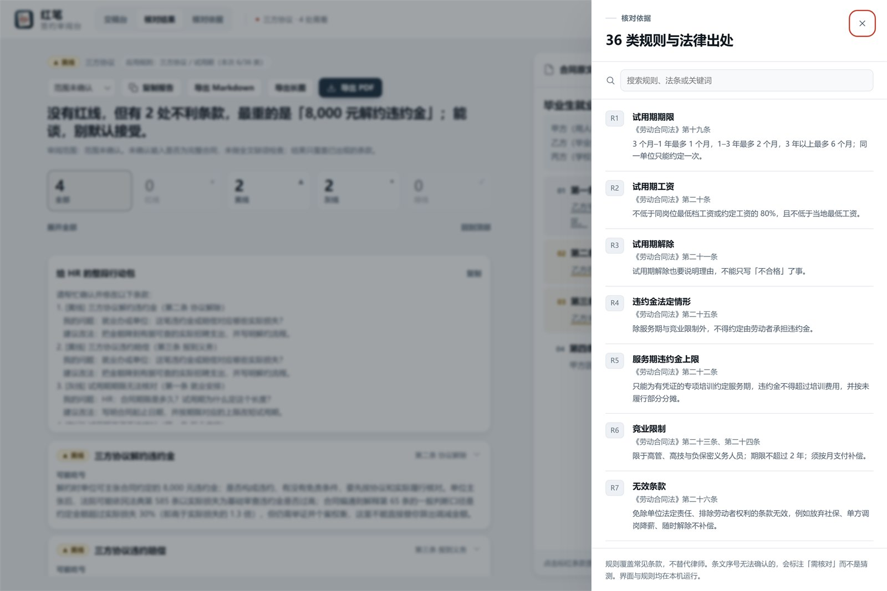
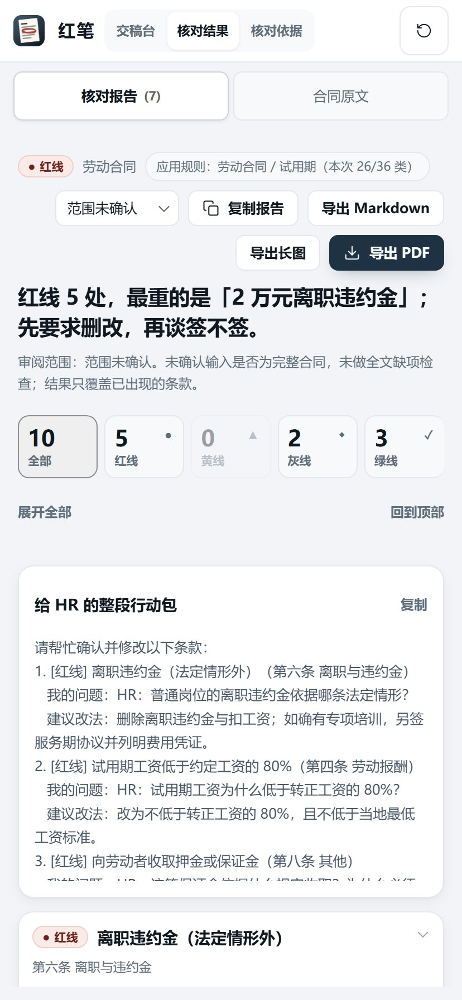

# 【Hack4Good】红笔：签约前 5 分钟，先看清每一行

2026 Qoder 高校创造力大赛 · Hack4Good 技术向善

作品地址：https://red-pen-x2o2rr9txoi.qoder.zone

代码仓库：https://github.com/SubmergeDQ/Red-Pen

## 一、自我介绍

西安工业大学，计算机科学与技术，大一。第一次拿到三方协议时，HR 说「都是标准模板，大家都这么签」，我盯着上面那句「提前解除本协议应向甲方支付违约金 8000 元」看了很久，没人能告诉我这句话签下去到底意味着什么。

我想做的就是把那 5 分钟补上：**在你签字之前，先有人用红笔把会伤到你的那几行划出来。**

## 二、作品是什么

**红笔（Red Pen）**——面向大学生的签约前合同风险审查工具。

粘贴合同条款，30 秒内输出一份逐条判定报告。每条争议条款回答三个问题：

| 问题 | 输出 |
|---|---|
| 这一条签了，最坏会发生什么？ | 具体场景 + 金额 + 时间，不写「存在法律风险」这种空话 |
| 这一条合不合法？依据是哪一条？ | 法律名称 + 条款序号 + 条款原文，可点开核对 |
| 我现在该问谁、问什么、要求改成什么？ | 一句话动作 + 一句可以直接发给 HR 的谈判话术 |

判定分四级：🔴 **红线**（与强制性规定冲突或法定无效，要求删除）、🟡 **黄线**（合法但明显不利，给出谈法）、⚪ **灰线**（需结合你的具体情况判断）、🟢 **绿线**（常规条款，一句话带过）。

覆盖 5 类文件、36 条规则：劳动合同、试用期、实习协议、三方协议、培训贷、预付课程。

## 三、为什么做

每年三月和六月，都有一批学生第一次面对「签字」。手里的三张纸——三方协议、实习协议、劳动合同——有三个共同点：

- **签的时候没人讲解。** HR 说「都是标准模板」，学校就业指导课讲的是流程，不是条款。
- **内容不可逆。** 三方协议签了要解约就得赔钱；试用期条款签了，离职时公司可以拿它说事。
- **出问题的时候已经晚了。** 等你发现违约金条款无效，你已经在准备应诉了。

现有工具都不对口。合同审查产品面向企业法务，一份几千字学生看不懂；法律咨询给的是通用问答，回答「违约金一般多少合理」，但不会告诉你**你手上这一条**具体意味着什么。

我要解决的就是这 5 分钟：把这三张纸上真正会伤到你的那几行找出来，说清楚。

## 四、怎么用

**网页版（打开即用）**：https://red-pen-x2o2rr9txoi.qoder.zone

**桌面 / 手机客户端**：https://github.com/SubmergeDQ/Red-Pen/releases

- Windows：`redpen-1.2.0-windows-x64-setup.exe`
- Android：`redpen-1.2.0-arm64-v8a.apk`（多数手机）或 `redpen-1.2.0-armeabi-v7a.apk`（较旧机型）

操作步骤：

1. 选文件类型（默认自动识别，识别不准可手动指定）；
2. 粘贴条款，或直接拖入 PDF / Word / TXT；
3. 看逐条判定报告；
4. 带走报告：导出 PDF / Markdown / 长图，或直接复制「报告 + 给 HR 的整段行动包」。

**所有内容只在浏览器内存里，不上传、不存储、断网也能用。** 页面顶部常驻一行「合同只在本机核对，不上传、不留存」——这不是一句宣传语，是这个产品唯一可能的实现方式。

## 五、用 Qoder 做出来的过程

这个作品从规则库到部署全部由 Qoder 完成。

**1. 规则库结构化。** 把《劳动合同法》《劳动法》《社会保险法》《民法典》《个人信息保护法》等法规整理成 36 条规则，统一 schema：触发正则 + 排除正则 + 法条原文 + 后果 + 问法 + 改法。Qoder 按 schema 补齐字段，我逐条人工核对法条序号和原文——**这一步不能交给模型**，模型编一个法条序号，整个产品就不可信了。

**2. 判定引擎。** `match` + `exclude` 双阶段匹配。这是整个项目最容易做错的地方：`/违约金/` 会命中几乎所有正常合同，因为合法的服务期、竞业限制条款里也出现这个词。没有 exclude 的规则库会把每一条都标红，产品第一眼就不可信。

Qoder 生成初版后，我人工把排除判断下沉到**句子级**：同一条里出现「服务期」不会让另一句违法的「提前离职赔 2 万」被漏掉。这个 bug 在测试里复现过三次，现在是固定回归用例。

**3. 多规则包调度。** 从「一个文件只跑一种规则」改成「主类型 + 正文信号追加规则包」。一份劳动合同里夹着「培训费分 12 期」，会同时跑劳动合同规则和培训贷规则。

这里有两个刻意的边界，都是我人工定的：

- **三方协议不按劳动合同判违约金。** 三方协议适用《民法典》的民事违约金规则，不能因为文本里出现「用人单位」就套用《劳动合同法》第二十五条。
- **纯实习协议里的「试用期」不直接套用劳动合同试用期上限。** 只有正文同时出现劳动者、用人单位等劳动信号，才追加试用期规则。

**4. 界面。** 判定卡片的四段式布局（原文 / 依据 / 后果 / 动作）反复调了三轮才做出「体检报告感」。移动端优先，与 Windows 客户端共用一套设计令牌。

**5. 测试。** 把规则引擎从单文件 HTML 里拆出来，成为浏览器和 Node 共用的 UMD 模块，然后补了 29 个回归用例，专门盯这几类容易复发的问题：百分比掩盖具体金额、同一条出现服务期导致漏判、甲方通知期误报、保护性条款被误判。

**6. 部署。** 通过 Qoder Sites 一键部署，评委点开即用。同时打包了 Windows 与 Android 客户端。

## 六、技术上的三个决定

**判定不交给模型。** 法条引用、金额计算、条款定位全部来自确定性规则模板。模型可能编造法条序号，断网演示就崩；规则判定可以被逐条验证，每一条规则都能单独截图演示，断网可用。报告里的解释文本也由模板直接生成，**判定、法条引用和金额计算都不经过模型**。

**不做后端。** 这个产品处理的是合同文本，天然带敏感信息。不做后端 = 不需要承诺「我们不会存你的合同」，因为根本没有地方存。这既是隐私设计，也是最省事的合规设计。

**不做第三方请求。** 页面只使用系统中文字体，连字体都不从 CDN 拉。打开页面不会向任何第三方发起请求，保持「断网可用、文本不上传」的一致性。

## 七、截图

*Qoder 中的部署过程：生成 `dist/site/index.html`（698KB 自包含）、上传草稿、发布并 commit，然后验证线上页面可加载。*

*首页：一句话说清产品是什么，右侧 5 份试用文本可以一键走完整流程。*

*2 年期劳动合同：10 条命中 5 条红线。试用期 6 个月、试用期工资 4800 元（低于 8000 的 80%）、2 万元离职违约金、收取押金，逐条给结论。*

*逐条卡片：每条给「可能吃亏」的具体判断、法条依据和调整口径。最后是「还要确认 4 件事」——不知道的就不装知道。*

*36 类规则全部公开，每条标出法条名称、序号和一句话解释。规则可被复核，是这个产品的立身之本。*

*移动端：签约现场掏出手机就能核，Windows / Android 客户端与网页版共用同一套判定。*

## 八、不足与反思

写在这里是因为它比成果本身更值得说。

**规则库覆盖仍不完整。** 36 条规则覆盖了高频风险，但劳动合同里的坑远不止这些——地方最低工资、社保基数、竞业补偿地方标准、复杂劳动关系认定，目前只能提示「去确认」。

**条款定位不精确。** 能判断内容，但很难准确定位到「第几条第几款」。没有编号时只能输出段落位置。

**不支持扫描件和手写批注。** 当前只接受文本粘贴，没有 OCR。真实合同照片往往带盖章、手写和表格排版，这一版直接不处理。

**最根本的问题：我不知道它有没有用。** 我做了判定逻辑，做了界面，但没有找真实的应届生用过。他们会不会在签字前想起来打开它？他们看得懂「服务期」和「竞业限制」的区别吗？这是我这个作品最大的空白。

**法条是静态的。** 法律会修订，规则库需要持续维护。现在它只是一个快照。

## 免责声明

本项目提供签约前风险提示，基于用户提供的文本和通用法律规定，**不构成法律意见**，不替代执业律师。涉及金额较大或已产生争议，请拨打 **12348** 公共法律服务热线，或联系所在学校的法律援助中心 / 学生资助管理中心。

